# US Grid Congestion and Curtailment Cost Mapping

**A national-scale data science project analyzing where transmission congestion and renewable curtailment is costing the most wasted clean energy across the United States, and where battery storage or new transmission investment would pay off the fastest.**

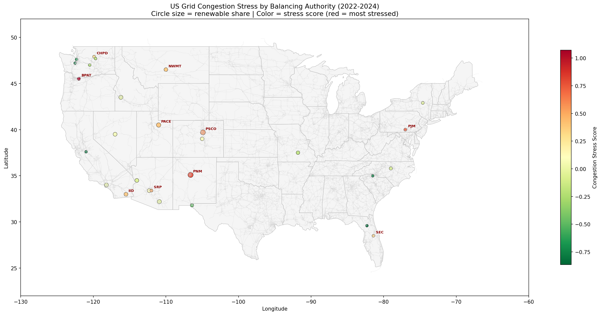

---

## Table of Contents

1. [What This Project Is About](#what-this-project-is-about)
2. [Why This Problem Matters](#why-this-problem-matters)
3. [Key Terminology](#key-terminology)
4. [Data Sources](#data-sources)
5. [Project Structure](#project-structure)
6. [Methodology](#methodology)
   - [Section 1: Loading and Cleaning EIA-930](#section-1-loading-and-cleaning-eia-930)
   - [Section 2: Supporting Datasets](#section-2-supporting-datasets)
   - [Section 3: Congestion Stress Score](#section-3-congestion-stress-score)
   - [Section 4: GIS Mapping](#section-4-gis-mapping)
   - [Section 5: Clustering -- Bottleneck Archetypes](#section-5-clustering----bottleneck-archetypes)
   - [Section 6: Time-Series Decomposition and Forecasting](#section-6-time-series-decomposition-and-forecasting)
   - [Section 7: Anomaly Detection](#section-7-anomaly-detection)
   - [Section 8: Cross-Region Statistical Comparison](#section-8-cross-region-statistical-comparison)
   - [Section 9: Battery Arbitrage Simulation](#section-9-battery-arbitrage-simulation)
   - [Section 10: Interconnection Queue Analysis](#section-10-interconnection-queue-analysis)
   - [Section 12: Advanced GIS Maps](#section-12-advanced-gis-maps)
7. [Key Findings](#key-findings)
8. [How to Run This Project](#how-to-run-this-project)
9. [Dependencies](#dependencies)

---

## What This Project Is About

The United States electrical grid is not one big system. It is divided into roughly 60 to 70 regional zones called **Balancing Authorities (BAs)**, each run by a grid operator responsible for keeping electricity supply and demand in balance within their territory at every hour of the day. When a BA produces more electricity than it can use locally, it needs to push that surplus out to neighboring regions through high-voltage transmission lines. When those lines are already running at or near their physical capacity, power cannot flow freely, and the grid becomes **congested**.

Congestion is expensive. It forces grid operators to curtail (shut down or throttle) power plants that are producing perfectly good electricity simply because there is no physical path to get that power to where it is needed. In practice, this means solar and wind farms in high-generation areas are told to stop producing, even though their fuel is free and their carbon emissions are zero. The power just gets wasted.

This project asks three questions:

1. **Where** across the entire US grid are congestion and curtailment happening most severely, and what structural factors explain which regions are worst?
2. **When** during the year is congestion worst, and is it getting worse over time?
3. **Where** would new battery storage or transmission investment pay off the fastest, in dollar terms?

The analysis covers 2022 through 2024, using three years of hourly data from every balancing authority in the continental US. The geographic scope is national, not limited to a single ISO or state. The GIS (Geographic Information System) component maps these findings onto the actual physical transmission network so you can see, not just measure, where the grid is straining.

---

## Why This Problem Matters

The US is adding solar and wind capacity faster than at any point in history. In 2023 alone, roughly 32 gigawatts of new wind and solar came online. But the transmission grid that moves that power from where it is generated to where people live was largely built decades ago, and it has not kept pace.

The result is a growing mismatch: clean energy that exists on paper but cannot reach customers because the wires are too thin or too few. The Department of Energy estimated that US curtailment of utility-scale solar and wind exceeded 7 million megawatt-hours in 2023. At an average wholesale electricity price of $40 per megawatt-hour, that is roughly $280 million worth of clean energy wasted in a single year.

Meanwhile, new clean energy projects trying to connect to the grid face wait times that have grown from under 2 years in 2008 to over 5 years today. More than 60 percent of projects that enter the interconnection queue eventually give up and withdraw, largely because the cost and timeline of the required grid upgrades make the economics unworkable.

This project is intended to produce the kind of quantitative analysis that transmission planners, energy regulators, clean energy developers, and infrastructure investors need to prioritize where to build.

---

## Key Terminology

**Balancing Authority (BA):** A regional grid operator responsible for keeping electricity supply exactly equal to demand within its territory at every moment. Examples include BPAT (Bonneville Power Administration, covering the Pacific Northwest), ERCO (covering Texas), and PJM (covering 13 Mid-Atlantic and Midwest states). There are 63 unique BAs in this dataset.

**Generation-Demand Surplus:** At any given hour, the difference between how much electricity a BA generates and how much it consumes. A positive surplus means the BA is producing more than it needs and must export the excess. A large or persistent surplus is a strong signal of congestion risk, because it means the BA is constantly trying to push power out and the transmission lines may not have enough capacity to handle it.

**Interchange:** The actual net flow of electricity between neighboring BAs, measured in megawatts. Positive interchange means a BA is receiving more power than it is sending. Negative interchange means it is exporting more than it receives. Chronic large negative interchange (heavy net exporting) combined with high renewable generation is the clearest signal of a congestion bottleneck.

**Curtailment:** The deliberate reduction or shutdown of a power plant's output because the grid cannot physically absorb or transmit that power at that moment. For renewable generators this means free, zero-emission electricity is simply thrown away.

**Locational Marginal Price (LMP):** The price of electricity at a specific point on the grid at a specific moment, determined by the market clearing process. When congestion occurs, prices at different nodes diverge dramatically. A solar farm in a congested area might face a price near zero or even negative (the grid is paying generators to stop), while consumers 100 miles away pay normal prices. This project uses generation-demand surplus as a proxy for LMP congestion because node-level LMP data requires per-ISO API credentials that are not uniformly available across all BAs.

**ISO/RTO:** Independent System Operator / Regional Transmission Organization. These are the market operators that run the wholesale electricity markets and coordinate dispatch across multiple balancing authorities. Examples: CAISO (California), ERCOT (Texas), PJM, MISO, SPP, ISO-NE, NYISO.

**Interconnection Queue:** The waiting list of proposed new power plants or transmission upgrades seeking permission to connect to the grid. Each proposed project must undergo technical studies to determine what grid upgrades are needed and who pays for them. The queue has become a severe bottleneck: as of 2025, there are over 38,000 projects in queues totaling over 2,600 gigawatts of proposed capacity.

**GIS (Geographic Information System):** A framework for storing, analyzing, and displaying data that has a geographic component. In this project, GIS tools (`geopandas`, `folium`) are used to overlay analytical results (stress scores, flow directions, density estimates) onto real-world maps of the US transmission network so that spatial patterns can be seen visually rather than just inferred from tables.

---

## Data Sources

All data used in this project is free and publicly available from official US government or national laboratory sources. No paid APIs, no web scraping.

### EIA-930 Hourly Electric Grid Monitor

**Source:** US Energy Information Administration (eia.gov)
**What it contains:** Hourly demand, generation, interchange, and fuel-mix data for every balancing authority in the continental US, going back to 2015. Each row is one BA at one hour. The dataset includes separate columns for solar, wind, hydro, gas, coal, and nuclear generation.
**Why we use it:** This is the only free, nationally consistent, hourly dataset that covers all 63 BAs under a single schema. It is the backbone of the entire analysis. We downloaded six files covering January 2022 through December 2024 (six months each), totaling about 1.6 million rows.
**Important detail:** EIA provides both raw reported values and "adjusted" values that fill in missing BA reports using interpolation. We use the adjusted versions throughout to minimize gaps.

### EPA eGRID 2023

**Source:** US Environmental Protection Agency (epa.gov)
**What it contains:** Annual generation totals, nameplate capacity, and CO2 emissions for every balancing authority, power plant, and grid subregion in the US, updated annually.
**Why we use it:** eGRID gives us the CO2 intensity (tons of CO2 per megawatt-hour) for each BA. This tells us whether a BA's generation fleet is fossil-heavy or already clean, which is an important structural variable in the clustering analysis. A BA that is high-stress AND high-carbon is a fundamentally different investment target than one that is high-stress but already mostly renewable.

### HIFLD Electric Power Transmission Lines

**Source:** Homeland Infrastructure Foundation-Level Data (HIFLD), US Department of Homeland Security, accessed via the ArcGIS Feature Service REST API (public, no authentication required).
**What it contains:** A shapefile of the entire US high-voltage transmission network, representing about 52,000 individual line segments with attributes including voltage level (kV), length, and the substations at each end.
**Why we use it:** Transmission lines are the physical infrastructure through which congestion either does or does not resolve. Overlaying them on a map with BA stress scores makes the bottleneck story visual and concrete: you can see where stressed BAs sit on thin, sparse stretches of the grid versus where they sit on dense, high-capacity corridors.
**How we downloaded it:** The API caps responses at 2,000 features per call. We paginated through the full dataset using a result offset parameter, assembling all pages into a single GeoJSON file (81 MB).

### LBNL Queued Up 2026

**Source:** Lawrence Berkeley National Laboratory (emp.lbl.gov), Energy Markets and Policy group.
**What it contains:** The most comprehensive publicly available dataset of the US interconnection queue, covering all ISOs and RTOs, with one row per proposed project including its technology type, proposed capacity, queue entry date, and final status (withdrawn, operational, active, or suspended).
**Why we use it:** The interconnection queue is the forward-looking layer of the analysis. High withdrawal rates in a region confirm that the congestion burden is not just a historical artifact but is actively preventing new clean energy from getting built. Cross-referencing queue stress with transmission stress from the EIA-930 data makes a much stronger argument than either dataset alone.
**Download:** This file cannot be programmatically downloaded because the server blocks automated requests. It must be manually downloaded from the LBNL website and placed in `data/lbnl_queue/queued_up_2026.xlsx`.

---

## Project Structure

```
grid_congestion_project/
|
|-- notebooks/
|   |-- grid_congestion_analysis.ipynb    # main analysis notebook
|
|-- data/
|   |-- eia930/                           # EIA-930 six-month CSV files (auto-downloaded)
|   |-- egrid/                            # EPA eGRID 2023 Excel file (auto-downloaded)
|   |-- hifld/                            # HIFLD transmission lines GeoJSON + US states
|   |-- lbnl_queue/                       # LBNL Queued Up Excel (manual download)
|
|-- download_data.py                      # script that auto-downloads EIA, eGRID, HIFLD
|
|-- congestion_stress_ranking.png
|-- congestion_map_static.png
|-- map_corridor_stress.png
|-- map_interchange_flows.png
|-- map_renewable_kde.png
|-- map_seasonal_stress.gif
|-- decomposition_BPAT.png
|-- forecast_BPAT.png
|-- anomaly_erco.png
|-- anomaly_trend_by_region.png
|-- cross_region_stress_comparison.png
|-- battery_arbitrage_value.png
|-- queue_by_region.png
|-- queue_withdrawal_trend.png
```

---

## Methodology

### Section 1: Loading and Cleaning EIA-930

The six EIA-930 CSV files are concatenated into a single dataframe with 1,626,431 rows. Column names are standardized from EIA's verbose format (e.g., "Net Generation (MW) from Solar") to short field names (`gen_solar_mw`). The timestamp column is parsed into a proper datetime and decomposed into year, month, and hour fields for later aggregation.

Three derived columns are computed here and used throughout the rest of the analysis:

- **`renewable_mw`**: the sum of solar and wind generation for each BA at each hour. Hydropower is excluded because it is dispatchable (the operator can choose when to release water), unlike solar and wind which generate whenever the resource is available.
- **`renewable_share`**: renewable_mw divided by total net generation. This captures how dependent a BA is on weather-driven generation, which is the root cause of surplus volatility.
- **`gen_demand_surplus`**: total net generation minus local demand. Positive values mean the BA is producing more than it consumes and must export the excess. This is the primary congestion proxy used throughout the project.

### Section 2: Supporting Datasets

**eGRID** is loaded from the BA23 tab of the Excel file. The sheet has an unusual two-row header: row 0 contains human-readable column names and row 1 contains short machine codes. We use `header=0, skiprows=[1]` to pick up row 0 as the header and discard row 1. CO2 intensity is derived as annual CO2 emissions divided by annual net generation.

**LBNL** is loaded from the "03. Complete Queue Data" sheet with `header=1` because row 0 is a navigation cell. Queue duration is computed as the number of days between a project's entry date and its resolution date (either the date it went operational or the date it withdrew).

### Section 3: Congestion Stress Score

The core analytical challenge is that we do not have node-level LMP prices for all 63 BAs. Instead, we build a composite **congestion stress score** from three features derived from the EIA-930 data:

1. **Average renewable share**: How much of a BA's generation comes from solar and wind on average? Higher renewable penetration means more surplus volatility and more curtailment risk, because solar and wind cannot be turned down when demand is low.

2. **Surplus volatility** (standard deviation of hourly generation-demand surplus): A BA that swings frequently between large surplus and large deficit is putting stress on its transmission boundaries in both directions. High volatility means the BA cannot be predicted or managed smoothly.

3. **Heavy export hours** (fraction of hours where surplus exceeds 50% of local demand): These are the hours where curtailment is most likely. When a BA is generating 50% more than its own consumers need, it must push enormous amounts of power out over its transmission lines. If those lines are already near capacity, some of the surplus simply cannot leave.

Each feature is z-scored (normalized to mean 0, standard deviation 1) so that they contribute equally to the composite score regardless of their raw units. The three z-scores are averaged into one stress score per BA. Higher scores indicate more congested, curtailment-prone regions.

**Result:** BPAT (Bonneville Power Administration, covering Oregon and Washington) ranked as the most stressed BA in the dataset, followed by PNM (New Mexico) and PJM (Mid-Atlantic/Midwest).

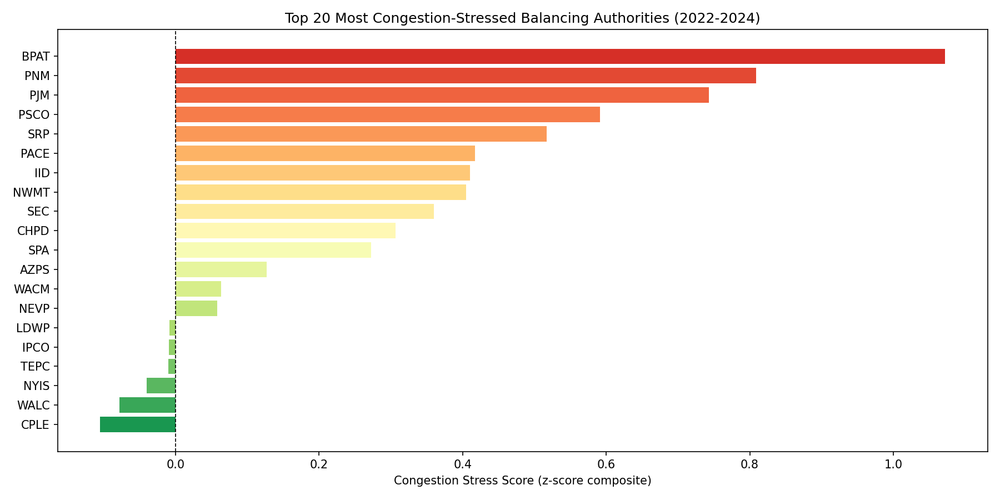

### Section 4: GIS Mapping

GIS is central to this project because congestion is inherently a spatial problem. The question is not just "which BAs are stressed" but "where are those BAs on the physical grid, and do their locations correspond to known thin corridors or structural bottlenecks?"

**Tools used:**
- `geopandas`: reads and reprojects spatial data (shapefiles, GeoJSON), performs spatial joins and clipping, renders map layers
- `folium`: builds interactive HTML maps with hover tooltips
- `shapely`: handles geometry operations (nearest-point lookup for the corridor stress map)
- `scipy.stats.gaussian_kde`: computes the kernel density surface for the renewable heatmap
- `matplotlib.animation.FuncAnimation`: renders the seasonal animation

**Coordinate system:** All layers are projected to EPSG:4326 (standard WGS84 latitude/longitude), the universal coordinate system used by web maps and GPS.

**Layer assembly:** The base maps use US state boundaries downloaded from a public GeoJSON repository (the `naturalearth_lowres` dataset was removed in geopandas 1.0, so we use a replacement from PublicaMundi's MappingAPI). Transmission lines from HIFLD are clipped to the continental US bounding box (-130 to -60 longitude, 22 to 52 latitude) to exclude Alaska, Hawaii, and Puerto Rico. BA centroid coordinates were manually compiled from EIA's own BA service territory reference maps.

**Static map (Section 4):** State outlines as a light gray base, HIFLD transmission lines as thin gray strokes, and BA centroids as circles colored on a red-to-green scale by stress score. Circle size is proportional to the BA's average renewable share so you can see at a glance which high-stress BAs also have the most renewables (those are the highest-priority curtailment candidates).


**Interactive map (Section 4):** A folium map at the same scale where each BA circle has a hover tooltip showing its name, region, stress score, renewable share, and heavy export hour percentage. Transmission lines are sampled every 10th segment to keep the HTML file size manageable.

### Section 5: Clustering -- Bottleneck Archetypes

A single stress score tells you how bad a BA is but not what kind of bad it is. K-means clustering on four features (renewable share, surplus volatility, heavy export hours, CO2 intensity) groups BAs into distinct archetypes that tell a richer story.

**Why k-means:** K-means is a simple, interpretable unsupervised algorithm that partitions observations into k groups by minimizing within-cluster variance. Each cluster's centroid (the mean of all four features for BAs in that group) can be read directly as the "personality" of that archetype.

**Choosing k:** We test values of k from 2 to 8 and select the one with the highest silhouette score. The silhouette score measures how similar each point is to its own cluster compared to the nearest other cluster (1 = perfectly separated, -1 = completely overlapping). The best k for this dataset was 8.

**Interpreting archetypes:** After fitting the model, the cluster centroids are inspected manually and labeled. Typical patterns that emerge include: high-renewable / high-surplus BAs (curtailment risk), volatile fossil-heavy BAs (demand-spike risk), small stable BAs with low stress, and large system operators with moderate stress across all dimensions.

### Section 6: Time-Series Decomposition and Forecasting

The highest-stress BA (BPAT) is selected for a deep time-series analysis. Hourly data is aggregated to daily averages to smooth out intra-day noise while preserving seasonal and trend structure.

**Seasonal decomposition:** The `statsmodels seasonal_decompose` function separates the daily surplus series into three additive components: trend (is congestion increasing over the three-year period?), seasonality (which time of year is worst?), and residual (unexplained variation after removing the other two). An additive model is used rather than multiplicative because the amplitude of seasonal swings stays roughly constant rather than growing in proportion to the trend level.

**SARIMA forecasting:** The daily series is aggregated further to monthly averages for the SARIMA model (Seasonal AutoRegressive Integrated Moving Average). The model specification is SARIMA(1,1,1)(1,1,1,12):

- `(1,1,1)`: AR order 1 (the value at time t depends on the value at t-1), first-order differencing (subtract the previous value to achieve stationarity), MA order 1 (the error at t depends on the error at t-1).
- `(1,1,1,12)`: the same AR/I/MA structure repeated at the 12-month seasonal lag, capturing the annual cycle of surplus that recurs each year.

The model is fit to the 36-month history and then extrapolated 12 months forward, with a 95% confidence interval around the forecast. The AIC (Akaike Information Criterion) for this model was 170.9, indicating a good fit relative to the model's complexity.

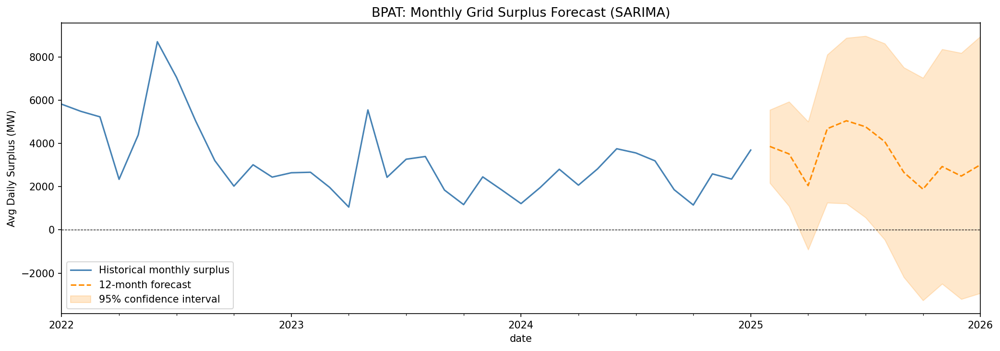

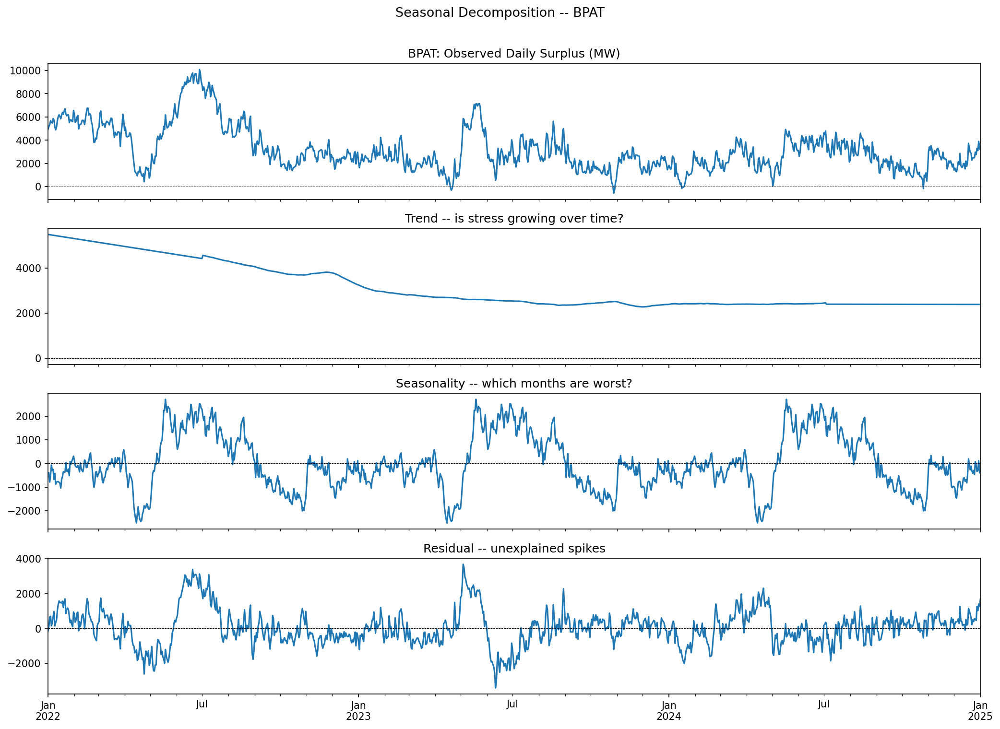

### Section 7: Anomaly Detection

Isolation Forest is applied to flag hours that are statistical outliers relative to each region's own baseline. The algorithm works by randomly partitioning the feature space with decision trees. Points that are anomalous (sitting in sparse, unusual parts of the feature space) get isolated with fewer splits than normal points, giving them a lower anomaly score. A contamination rate of 1% means we expect and flag approximately 1 in 100 hours as anomalous.

The model is fit **per region, not globally**. This is important because the scale of demand and generation varies by orders of magnitude between a large operator like PJM and a small operator like TIDC. Fitting globally would flag all TIDC hours as anomalous simply because their numbers are small. Per-region fitting means each BA is compared against its own normal range.

Features used: demand, total generation, renewable output, interchange, and generation-demand surplus. All five are z-scored before fitting so that no single feature dominates.

**Result:** 13,907 hours were flagged as anomalous, representing exactly 1.00% of the 1.39 million hours analyzed. When plotted for ERCOT (Texas), the flagged hours cluster visibly around summer 2023, when Texas set consecutive all-time demand records and came close to emergency grid conditions multiple times.

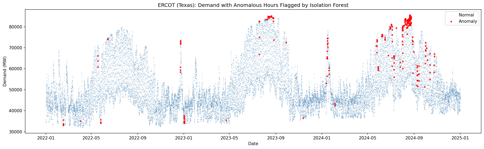

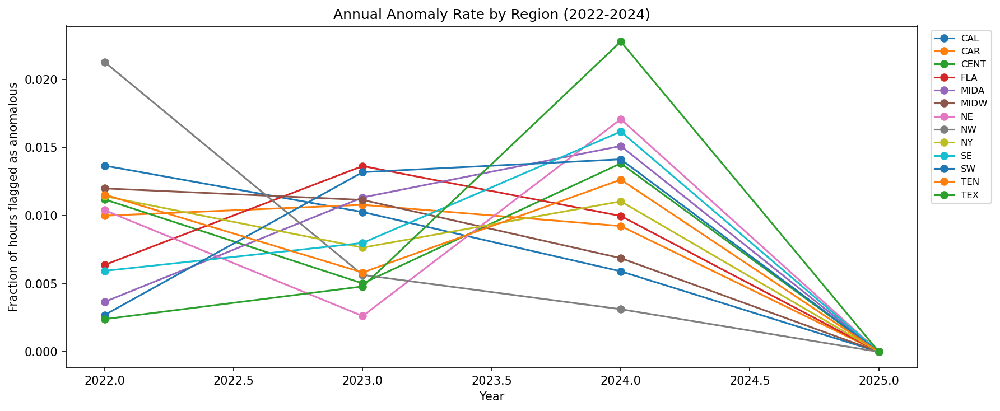

### Section 8: Cross-Region Statistical Comparison

To formally test whether different regions have statistically different congestion stress profiles, we compute monthly surplus volatility (standard deviation of hourly surplus) per BA per month, then group by the 13 EIA regions. The Kruskal-Wallis test (the non-parametric equivalent of one-way ANOVA) tests the null hypothesis that all regions share the same distribution of monthly stress.

We choose a non-parametric test because the stress distribution is right-skewed: a small number of extreme months dominate, violating the normality assumption that standard ANOVA requires. The Kruskal-Wallis test makes no distributional assumptions -- it only requires that the data be ordinal.

**Result:** H-statistic = 528.33, p = 2.05e-105. The regions are not even close to having the same stress distribution. This confirms that regional differences in grid congestion are real and structural, not statistical noise, and that market design, generation mix, and grid topology explain meaningful variation in outcomes.

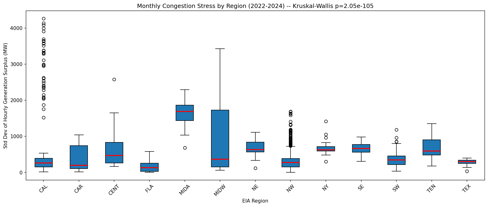

### Section 9: Battery Arbitrage Simulation

For the 20 highest-stress BAs, a 100 MW / 4-hour battery (400 MWh total capacity) is simulated over the full three-year hourly dataset using a simple rule: charge when the BA has a generation surplus (grid has excess power, curtailment risk), discharge when the BA has a deficit (grid is tight, power needs to come from somewhere).

The simulation tracks state of charge (SOC) hour by hour, respecting:
- The 100 MW power limit (cannot charge or discharge faster than 100 MW at any hour)
- The 400 MWh energy limit (cannot store more than 400 MWh or discharge below zero)
- An 85% round-trip efficiency (for every 100 MWh charged, only 85 MWh comes back out)

Total MWh absorbed over three years is annualized and multiplied by a conservative $30/MWh curtailment avoidance value (drawn from NREL's estimates of the avoided cost of curtailed renewable energy) to produce an annual dollar value for each BA.

**Result:** The top-ranked BA for battery value was CPLE (Duke Energy Carolinas Progress, North Carolina) at $4.1M/year, followed by WALC (Western Area Power Administration, Southwest) at $3.1M/year.

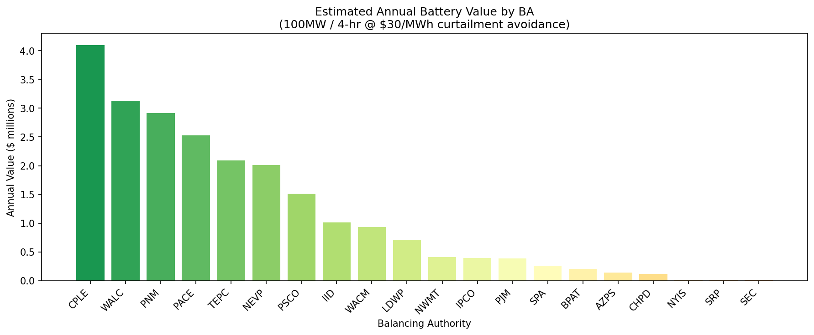

### Section 10: Interconnection Queue Analysis

The LBNL dataset is aggregated by ISO/RTO region to compute two metrics: the withdrawal rate (what fraction of proposed projects gave up before completing interconnection) and the average time spent in the queue.

Queue status values are: `withdrawn`, `operational`, `active`, and `suspended`. The withdrawn flag is applied using an exact string match to avoid false positives from partial matches.

**Result by region:**
- NYISO: 79.1% withdrawal rate (highest)
- CAISO: 76.7%
- ISO-NE: 76.6%
- PJM: 68.2%
- ERCOT: 30.8% (lowest -- Texas's deregulated market has simpler interconnection rules)

The trend analysis groups projects by the year they entered the queue (not the year they resolved) to ask whether more recent cohorts are withdrawing at higher rates. The answer is yes: projects entering the queue in 2015 through 2020 have far higher realized withdrawal rates than those entering before 2010, consistent with the growing backlog.

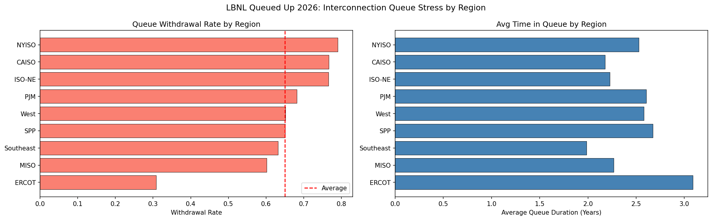

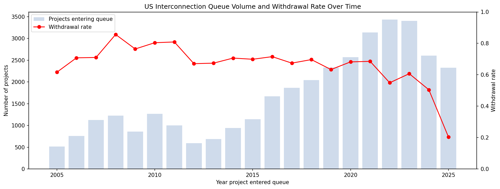

### Section 12: Advanced GIS Maps

Four additional maps were built to visualize the analysis from different spatial angles.

#### Map 1: Transmission Corridor Stress

**What:** Every HIFLD transmission line segment is colored on a red-to-green scale by the stress score of the nearest balancing authority centroid.

**Why:** The basic map in Section 4 shows BA centroids as dots. But the relevant geography is the actual wires. Painting the lines reveals whether stressed BAs sit on thin, isolated stretches of the network (a structural problem that only new transmission can solve) or on dense, high-capacity corridors (where congestion may be solvable through operational improvements or storage).

**How:** For each sampled line segment, we compute the centroid of its geometry, then find the nearest BA centroid using `shapely.ops.nearest_points` on the spatial union of all BA centroids (this is more efficient than computing pairwise distances for all 10,000+ sampled segments). The stress score of the matched BA is assigned to the line. Lines are then binned into 8 quantile buckets and drawn with `geopandas.plot()`, which handles both LineString and MultiLineString geometries correctly.

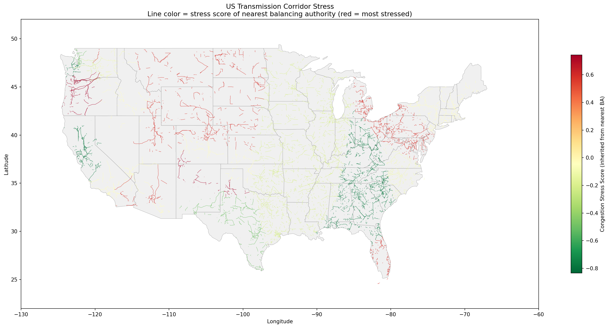

#### Map 2: Net Interchange Flow Map

**What:** Each BA is shown as a circle at its centroid, colored red if it is a chronic net power exporter and blue if it is a chronic net importer, with circle size and arrow length proportional to the magnitude of average net interchange.

**Why:** Congestion is ultimately a flow problem. The interchange map shows the direction of stress: which BAs are constantly pushing surplus power out and which are pulling it in. Exporters surrounded by thin transmission infrastructure (visible in Map 1) are the clearest bottleneck candidates. An interactive folium version is also saved so the exact MW values can be inspected by hovering.

**How:** Average net interchange per BA is computed from the EIA-930 data. EIA's convention is that positive interchange means a BA is receiving more power than it is sending (net importer), and negative interchange means it is sending more than it receives (net exporter). A `TwoSlopeNorm` color scale is used so that the zero crossing (balanced BA) appears as white/neutral regardless of the overall range of values.

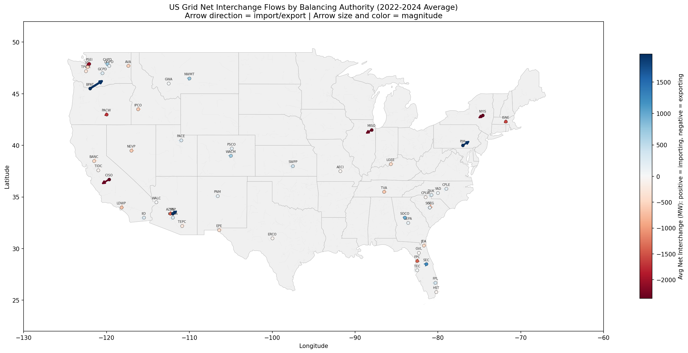

#### Map 3: Renewable Generation Density (KDE Heatmap)

**What:** A smooth heatmap showing where solar and wind generation is geographically concentrated across the US, with transmission lines visible underneath.

**Why:** Renewable curtailment happens when generation is concentrated in areas where the transmission network cannot carry all the power out. A renewable generation hotspot sitting on top of sparse gray lines in Map 3 is a direct visual representation of the transmission-renewables mismatch.

**How:** A weighted point cloud is constructed by repeating each BA's coordinates a number of times proportional to its average renewable output (more MW = more points). This means the kernel density estimator produces a surface whose height is proportional to megawatts of generation, not just the count of BAs in an area. `scipy.stats.gaussian_kde` with a bandwidth of 0.15 is fitted to the point cloud. The density is evaluated on a 300x200 grid covering the continental US and rendered as filled contours with `matplotlib.contourf`.

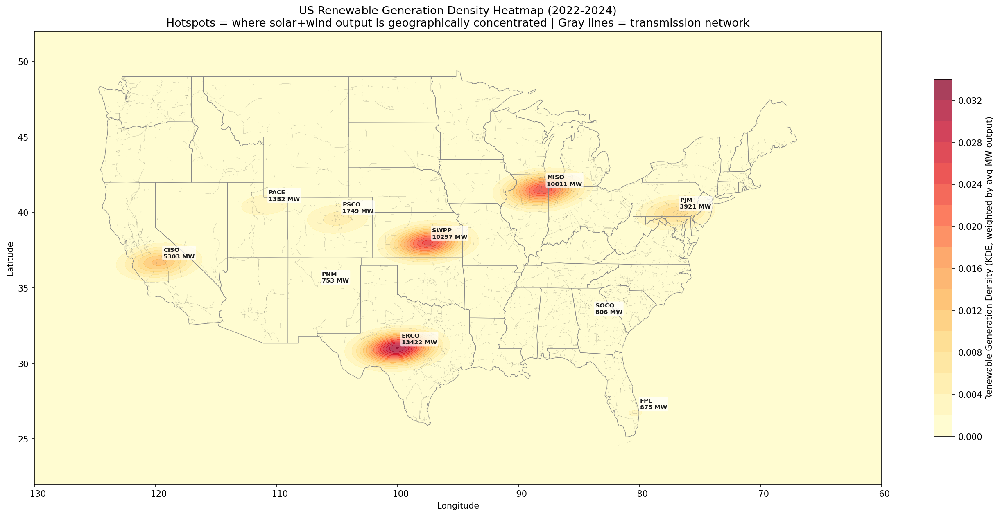

#### Map 4: Seasonal Stress Animation

**What:** An animated GIF cycling through Spring, Summer, Fall, and Winter, showing how the congestion stress score of each BA changes across seasons. Colored badge strips at the bottom of each frame indicate which season is active.

**Why:** A single annual-average map hides the most operationally important variation. The Pacific Northwest is most stressed in late summer when snowmelt-driven hydro output peaks and wind also picks up, overwhelming transmission capacity. The Desert Southwest is most stressed in summer when air conditioning demand peaks along with solar generation. Wind-heavy Great Plains BAs are most stressed in spring when wind generation peaks and low temperatures keep demand low. Seeing these shifts animated makes the case for seasonal storage or transmission solutions far more clearly than any table.

**How:** The EIA-930 hourly data is split into four seasonal subsets and the three-feature stress score is recomputed independently for each season. A fixed color scale (based on the global 5th and 95th percentile across all seasons) ensures that colors are directly comparable across frames. `matplotlib.animation.FuncAnimation` loops over the four frames and `PillowWriter` exports the result as a GIF at 0.8 frames per second.

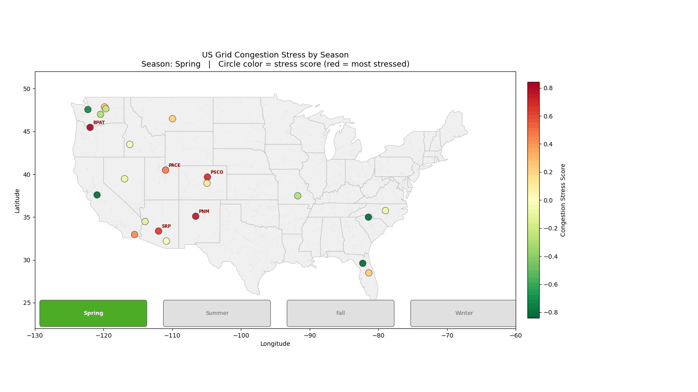

---

## Key Findings

**Most congestion-stressed balancing authorities (2022-2024):**
1. BPAT (Bonneville Power Administration, Pacific Northwest) -- stress score 1.07
2. PNM (New Mexico) -- 0.81
3. PJM (Mid-Atlantic / Midwest) -- 0.74

**Interconnection queue (LBNL):**
- NYISO leads in withdrawal rate at 79%, meaning nearly 4 in 5 proposed projects in New York give up before reaching the grid.
- ERCOT (Texas) is the outlier with only a 31% withdrawal rate, reflecting its simpler, less congested interconnection process.

**Battery arbitrage:**
- A 100 MW / 4-hour battery at CPLE (North Carolina) would capture an estimated $4.1M per year in curtailment avoidance value.
- The Southwest region (WALC, PNM, TEPC) consistently shows high battery value due to strong solar surplus coinciding with transmission constraints.

**Statistical significance:**
- The Kruskal-Wallis test confirms that regional differences in congestion stress are highly statistically significant (H = 528.33, p = 2.05e-105), meaning grid congestion is not randomly distributed but is systematically worse in certain regions due to structural factors.

**Anomaly detection:**
- Isolation Forest flagged 1.00% of hours as anomalous, with ERCOT's summer 2023 demand records clearly visible as a cluster of flagged points.

---

## How to Run This Project

### Step 1: Download automatic data

```bash
python download_data.py
```

This downloads EIA-930 (six files, ~240 MB total), EPA eGRID (20 MB), and HIFLD transmission lines (81 MB). It will skip any files that already exist.

### Step 2: Download LBNL data manually

Go to [https://emp.lbl.gov/queues](https://emp.lbl.gov/queues), download the Excel file labeled "Queued Up 2026 Data File", and place it at:

```
data/lbnl_queue/queued_up_2026.xlsx
```

### Step 3: Open JupyterLab and run the notebook

```bash
jupyter lab notebooks/grid_congestion_analysis.ipynb
```

Select the `Python (lunar)` kernel and run all cells top to bottom. Section 12 (advanced GIS maps) will run last and save five output files. The seasonal animation (Map 4) takes approximately 60 to 90 seconds because it recomputes the stress score four times.

---

## Dependencies

All dependencies should be installed in the conda environment used for this project. The required packages are:

```
pandas
numpy
geopandas
folium
matplotlib
scipy
scikit-learn
statsmodels
openpyxl
shapely
pillow
```

Install with:

```bash
pip install pandas numpy geopandas folium matplotlib scipy scikit-learn statsmodels openpyxl shapely pillow
```

---

*Data coverage: January 2022 through December 2024. All dollar estimates use 2023 wholesale market prices. Battery value estimates are illustrative and based on a conservative $30/MWh curtailment avoidance assumption from NREL published estimates.*
